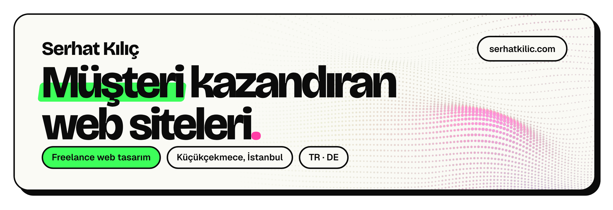

<a href="https://www.serhatkilic.com/">
  <picture>
    <source media="(prefers-color-scheme: dark)" srcset="assets/banner-dark.png">
    
  </picture>
</a>

  
  
  

**TR** · İstanbul'da freelance web tasarımcıyım. Hızlı açılan, Google'da bulunan ve müşteri getiren web siteleri yapıyorum.

**EN** · Freelance web designer in Istanbul. I build fast websites that rank on Google and turn visitors into customers.

**DE** · Freiberuflicher Webdesigner aus Istanbul. Ich baue schnelle Websites, die bei Google gefunden werden und Kunden bringen.

| TR | EN | DE |
|---|---|---|
| Kurumsal web sitesi | Business website | Unternehmenswebsite |
| Landing page | Landing page | Landingpage |
| Teknik SEO ve hız | Technical SEO & speed | Technisches SEO & Speed |
| Site yenileme | Website redesign | Website-Relaunch |

**Seçili işler · Selected work · Referenzen**

[Mali Asistanım](https://maliasistanim.com/) · [Kıran Makine](https://kiranmakine.com/) · [KLC Elektro](https://klc-elektro.de/) · [Rohrreinigung Nähe](https://www.rohrreinigung-naehe.de/) · [Taxi Velbert](https://velbertertaxi.de/) · [BRS Technik](https://brstechnik.de/) · [Salve Mondo](https://www.salvemondo.com/)

**Stack** · HTML5 · CSS · JavaScript · PHP 8 · MySQL · WordPress

**İletişim · Contact · Kontakt** · [WhatsApp](https://wa.me/905419332730) · [iletisim@serhatkilic.com](mailto:iletisim@serhatkilic.com)
